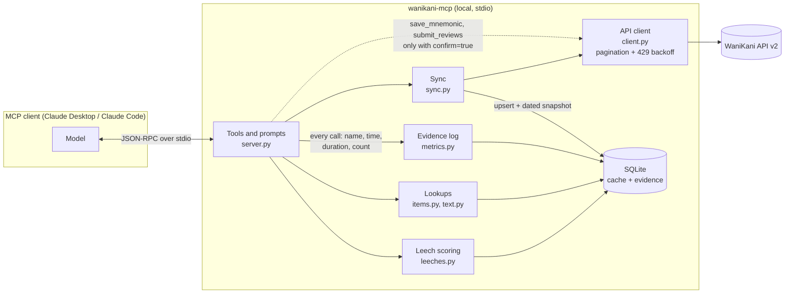

# WaniKani MCP

An [MCP](https://modelcontextprotocol.io) server that lets an AI assistant work with your own
[WaniKani](https://www.wanikani.com) data. It can:

- **find your leeches**: the kanji and vocabulary you keep getting wrong, ranked worst first;
- **explain why you miss them**: it gives the model the facts it needs (readings, components,
  look-alike kanji and your scores on them, mnemonics) and the model does the analysis;
- **write practice at your level**: reading material that only uses kanji you've learned,
  checked by a guardrail tool before you see it;
- **review in context**: read a news article or story, answer questions on the WaniKani words
  in it, and have correct answers on due items count as real WaniKani reviews (opt-in).

It is small (about 2,000 lines of Python across 10 modules), read-only by default, keeps your data on your machine,
and logs evidence of its own use so you can show results.

## Tools and prompts

| Tool | What it does | Writes to WaniKani? |
| --- | --- | --- |
| `sync` | Pulls your data into the local SQLite cache. After the first run it only fetches changes (`updated_after`). Reports new/updated records, SRS movement and leeches gained or cured. | No |
| `find_leeches(limit, item_type, include_burned)` | Ranks your worst items using the leech formula below. Says whether meaning or reading is the weak side. | No |
| `explain_item(item)` | Takes characters (`静`, `評論`), a radical name, or a subject id. Returns meanings, on'yomi and kun'yomi readings, component radicals, visually similar kanji with *your* scores on them, your accuracy and streaks, the default mnemonics, your notes, and known vocabulary that uses the kanji. | No |
| `known_items(min_srs_stage, item_type)` | The kanji (as one compact string) and vocabulary you've reached: 1 = started, 5 = Guru, 9 = Burned. | No |
| `check_text(text, min_srs_stage)` | Flags every kanji in a Japanese text that you haven't learned, with its WaniKani level and meaning so the model can rewrite it. | No |
| `save_mnemonic(item, meaning_note, reading_note, confirm)` | Saves a personal note to your study materials. It always returns a before/after preview first, and only writes with `confirm=true` **and** `WANIKANI_MCP_ALLOW_WRITES=1`. | **Yes** (opt-in) |
| `due_items(limit)` | Your reviews due right now, fetched live. Vocabulary comes first because it's easiest to use in context. | No |
| `find_wanikani_words(text)` | Lists the WaniKani vocabulary in a Japanese text (exact forms plus verb and adjective stems, e.g. 働いた → 働く), due items first. | No |
| `grade_answer(item, meaning_answer, reading_answer, model_judgement)` | Grades an answer against WaniKani's accepted answers and records the result locally. | No |
| `submit_reviews(confirm)` | Turns this session's graded answers into real WaniKani reviews. Preview first, then `confirm=true`, behind the same write switch. | **Yes** (opt-in) |

| Prompt | Workflow |
| --- | --- |
| `drill_leeches` | find leeches → explain each → diagnose the root cause → quiz you one by one → offer a new mnemonic (preview first, then save if you agree) |
| `story_at_my_level` | known items → write a story that uses some of your leech words → `check_text` → rewrite until clean → story, word list, hidden translation |
| `read_and_review` | due items → a news article (Claude fetches it, e.g. NHK News Web Easy, or you paste it) or a story built around them → quiz each word in its sentence → grade → preview → submit if you agree |

## Architecture



Tools read from the local cache, so they answer in milliseconds and don't use up the API's
rate limit. Only `sync`, `due_items` and the two write tools call WaniKani.

## The leech formula

From the WaniKani community's leech-training scripts:

```text
score = incorrect / max(current_streak, 1) ** 1.5
```

worked out **separately for meaning and reading**. The item's score is the worse of the two, and
**score ≥ 1 counts as a leech**.

- Many wrong answers push the score up, and a run of correct answers brings it down quickly. An item
  you got wrong 8 times but have now answered right 4 times in a row scores 8 / 4^1.5 = 1.0. Get it
  right once more and it drops below the line.
- A streak of 0 (you just got it wrong) is treated as 1, so there's no division by zero.
- Radicals and kana-only vocabulary have no reading question, so only their meaning score counts.
- Burned items are skipped by default because you no longer review them.

To change it, set `WANIKANI_LEECH_EXPONENT` and `WANIKANI_LEECH_THRESHOLD`, or edit `leech_score()` in
[`src/wanikani_mcp/leeches.py`](src/wanikani_mcp/leeches.py). It's one line, and the tests in
`tests/test_leeches.py` document the expected behaviour.

## Reviews in context

A normal WaniKani review asks for the meaning and the reading, with nothing else on screen to
help. A question about a sentence is easier, so the rules are set to stop easy passes from moving
items up the SRS levels too fast:

- **Meaning and reading.** Kanji and vocabulary count only if you show the meaning (in English, or
  in Japanese) **and** type the reading in kana. Radicals and kana-only words need only the meaning.
  A meaning-only answer is logged as practice.
- **Only due items.** WaniKani's API only accepts reviews for items that are due. Answers on other
  items are kept as practice and show up in `stats`.
- **Graded by the server.** `grade_answer` checks answers against WaniKani's accepted meanings,
  whitelisted alternatives, your own synonyms and readings, allowing small typos. Katakana counts as
  hiragana. A valid reading WaniKani isn't asking for (kun'yomi when it wants on'yomi) is sent back
  to retry, as on the site. If an answer doesn't match WaniKani's list (for example a Japanese
  explanation), the model must make a call, and the preview marks that call as the model's.
  `submit_reviews` only sends grades the server recorded, so the model can't submit a pass on its
  own.
- **Wrong answers are not submitted by default.** Set `WANIKANI_MCP_SUBMIT_INCORRECT=1` to send
  them as incorrect reviews. The preview shows the expected SRS change, using WaniKani's penalty
  rule (drop by ⌈wrong answers / 2⌉ stages, doubled from Guru up).
- **Confirm before sending.** Reviews can't be undone, so `submit_reviews` returns a preview and
  needs `confirm=true`, plus `WANIKANI_MCP_ALLOW_WRITES=1`. Before sending, it re-checks each item
  with the API, so an item you already reviewed on the website isn't submitted twice.
- **News articles** come from Claude's own web tools or from you pasting them in. The server doesn't
  scrape websites. Word matching is by written form and stem, so it can pick the wrong word
  (降りました may match 降りる when the sentence means 降る), and the prompt tells the model to check
  each match in context.

## Setup

Requires Python 3.12+ and [uv](https://docs.astral.sh/uv/).

```bash
git clone <this repo> && cd WanikaniMCP
uv sync
```

Get a read-only API token from WaniKani → Settings → API Tokens. Only tick the *study_materials*
permissions if you want `save_mnemonic` to be able to write.

```bash
export WANIKANI_API_TOKEN=...          # your shell only; never commit it
uv run wanikani-mcp sync               # first sync: about 50 requests, about 20 seconds at level 60
uv run wanikani-mcp stats
```

### Claude Code

```bash
claude mcp add wanikani --scope user \
  -e WANIKANI_API_TOKEN=your-token \
  -- uv --directory /absolute/path/to/WanikaniMCP run wanikani-mcp
```

### Claude Desktop

Add to `claude_desktop_config.json` (Settings → Developer → Edit Config):

```json
{
  "mcpServers": {
    "wanikani": {
      "command": "uv",
      "args": ["--directory", "/absolute/path/to/WanikaniMCP", "run", "wanikani-mcp"],
      "env": { "WANIKANI_API_TOKEN": "your-token" }
    }
  }
}
```

To let `save_mnemonic` and `submit_reviews` write, add `"WANIKANI_MCP_ALLOW_WRITES": "1"` to `env`
(or `-e` for Claude Code). Your token needs the matching permissions (*study_materials* and *reviews:create*).

### Configuration

| Variable | Default | Purpose |
| --- | --- | --- |
| `WANIKANI_API_TOKEN` | (required for `sync`) | WaniKani API v2 token |
| `WANIKANI_MCP_DB` | `~/.wanikani-mcp/cache.db` | Cache and evidence database |
| `WANIKANI_MCP_ALLOW_WRITES` | unset (read-only) | `1` lets `save_mnemonic` and `submit_reviews` write |
| `WANIKANI_MCP_SUBMIT_INCORRECT` | unset | `1` sends items you got wrong as incorrect reviews |
| `WANIKANI_LEECH_EXPONENT` | `1.5` | Leech formula exponent |
| `WANIKANI_LEECH_THRESHOLD` | `1.0` | Leech cut-off |

## Privacy choices

- **Token handling.** The token is read from the environment only. It is never printed or logged,
  never written to the cache, and kept out of error messages and the client's `repr`. A test checks the
  whole database dump for it. httpx request logging is turned down to warnings.
- **Read-only by default.** Only `save_mnemonic` and `submit_reviews` can write, and both are off
  unless you set `WANIKANI_MCP_ALLOW_WRITES=1`. Even then each one returns a preview and needs a
  second call with `confirm=true`. `save_mnemonic` only changes the note fields you pass in.
- **Local cache only.** Your data stays in a SQLite file on your machine. The only user field stored is
  your level (no username or email). Nothing is sent anywhere except to WaniKani's API.
- **Evidence log without content.** Tool calls are logged as name, time, duration, item count and
  success. Arguments and results are not logged. `check_text` stores counts, never the text, and
  context quizzes store outcomes (passed, number of wrong answers), never your answers.
- **Test fixtures** are real API responses recorded with [`scripts/record_fixtures.py`](scripts/record_fixtures.py),
  with the username, user id, profile URL and note text replaced.

## Evidence and `stats`

Every sync saves a dated snapshot of the leech list and overall accuracy. Every tool call is logged.
`uv run wanikani-mcp stats` (or `stats --json`) prints:

- number of sessions and tool calls, error rate, and median latency per tool;
- leeches surfaced, and leech count and accuracy at the first sync vs now (cured and new leeches);
- how often `check_text` found unknown kanji in generated text (the guardrail's catch rate);
- context quizzes: items quizzed, first-try pass rate, meanings judged by the model, and reviews
  submitted vs kept as practice;
- estimated time saved, using per-tool estimates in `MINUTES_SAVED` in `metrics.py`.

## Results

*Fill in from `uv run wanikani-mcp stats` after a few weeks of use.*

| Metric | First sync | After N weeks |
| --- | --- | --- |
| Date | | |
| Leech count | | |
| Overall accuracy | | |
| Leeches cured | – | |
| Sessions / tool calls | – | |
| Tool error rate | – | |
| `check_text` runs that caught unknown kanji | – | |
| Context reviews submitted (correct / incorrect) | – | |
| Estimated time saved | – | |

## Development

```bash
uv run pytest            # about 90 tests, no network: recorded fixtures via httpx.MockTransport
```

The tests cover pagination, 429 backoff (including `RateLimit-Reset`), the leech formula, incremental
sync and snapshots, `check_text`, the `save_mnemonic` confirm flow, word matching and grading, the
SRS rule, the full read-and-review flow (including rejected reviews and items reviewed elsewhere),
cache migration, and the MCP protocol using the SDK's in-process client.

Built with the official [MCP Python SDK](https://github.com/modelcontextprotocol/python-sdk) v2
(`MCPServer`, formerly `FastMCP`), httpx and SQLite.
