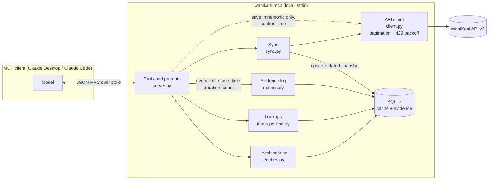

# WaniKani MCP

An [MCP](https://modelcontextprotocol.io) server that lets an AI assistant work with your own
[WaniKani](https://www.wanikani.com) data. It can:

- **find your leeches**: the kanji and vocabulary you keep getting wrong, ranked worst first;
- **explain why you miss them**: it gives the model the facts it needs (readings, components,
  look-alike kanji and your scores on them, mnemonics) and the model does the analysis;
- **write practice at your level**: reading material that only uses kanji you've learned,
  checked by a guardrail tool before you see it.

It is small (about 1,500 lines of Python across 9 modules), read-only by default, keeps your data on your machine,
and logs evidence of its own use so you can show results.

## Tools and prompts

| Tool | What it does | Writes to WaniKani? |
| --- | --- | --- |
| `sync` | Pulls your data into the local SQLite cache. After the first run it only fetches changes (`updated_after`). Reports new/updated records, SRS movement and leeches gained or cured. | No |
| `find_leeches(limit, item_type, include_burned)` | Ranks your worst items using the leech formula below. Says whether meaning or reading is the weak side. | No |
| `explain_item(item)` | Takes characters (`静`, `評論`), a radical name, or a subject id. Returns meanings, on'yomi and kun'yomi readings, component radicals, visually similar kanji with *your* scores on them, your accuracy and streaks, the default mnemonics, your notes, and known vocabulary that uses the kanji. | No |
| `known_items(min_srs_stage, item_type)` | The kanji (as one compact string) and vocabulary you've reached: 1 = started, 5 = Guru, 9 = Burned. | No |
| `check_text(text, min_srs_stage)` | Flags every kanji in a Japanese text that you haven't learned, with its WaniKani level and meaning so the model can rewrite it. | No |
| `save_mnemonic(item, meaning_note, reading_note, confirm)` | Saves a personal note to your study materials. It always returns a before/after preview first, and only writes with `confirm=true` **and** `WANIKANI_MCP_ALLOW_WRITES=1`. | **Yes** (opt-in) |

| Prompt | Workflow |
| --- | --- |
| `drill_leeches` | find leeches → explain each → diagnose the root cause → quiz you one by one → offer a new mnemonic (preview first, then save if you agree) |
| `story_at_my_level` | known items → write a story that uses some of your leech words → `check_text` → rewrite until clean → story, word list, hidden translation |

## Architecture



Tools read from the local cache, so they answer in milliseconds and don't use up the API's
rate limit. Only `sync` and `save_mnemonic` call WaniKani.

## The leech formula

From the WaniKani community's leech-training scripts:

```text
score = incorrect / max(current_streak, 1) ** 1.5
```

worked out **separately for meaning and reading**. The item's score is the worse of the two, and
**score ≥ 1 counts as a leech**.

- Many wrong answers push the score up, and a run of correct answers brings it down quickly. An item
  you got wrong 8 times but have now answered right 4 times in a row scores 8 / 4^1.5 = 1.0. Get it
  right once more and it drops below the line.
- A streak of 0 (you just got it wrong) is treated as 1, so there's no division by zero.
- Radicals and kana-only vocabulary have no reading question, so only their meaning score counts.
- Burned items are skipped by default because you no longer review them.

To change it, set `WANIKANI_LEECH_EXPONENT` and `WANIKANI_LEECH_THRESHOLD`, or edit `leech_score()` in
[`src/wanikani_mcp/leeches.py`](src/wanikani_mcp/leeches.py). It's one line, and the tests in
`tests/test_leeches.py` document the expected behaviour.

## Setup

Requires Python 3.12+ and [uv](https://docs.astral.sh/uv/).

```bash
git clone <this repo> && cd WanikaniMCP
uv sync
```

Get a read-only API token from WaniKani → Settings → API Tokens. Only tick the *study_materials*
permissions if you want `save_mnemonic` to be able to write.

```bash
export WANIKANI_API_TOKEN=...          # your shell only; never commit it
uv run wanikani-mcp sync               # first sync: about 50 requests, about 20 seconds at level 60
uv run wanikani-mcp stats
```

### Claude Code

```bash
claude mcp add wanikani --scope user \
  -e WANIKANI_API_TOKEN=your-token \
  -- uv --directory /absolute/path/to/WanikaniMCP run wanikani-mcp
```

### Claude Desktop

Add to `claude_desktop_config.json` (Settings → Developer → Edit Config):

```json
{
  "mcpServers": {
    "wanikani": {
      "command": "uv",
      "args": ["--directory", "/absolute/path/to/WanikaniMCP", "run", "wanikani-mcp"],
      "env": { "WANIKANI_API_TOKEN": "your-token" }
    }
  }
}
```

To let `save_mnemonic` write, add `"WANIKANI_MCP_ALLOW_WRITES": "1"` to `env` (or `-e` for Claude Code).

### Configuration

| Variable | Default | Purpose |
| --- | --- | --- |
| `WANIKANI_API_TOKEN` | (required for `sync`) | WaniKani API v2 token |
| `WANIKANI_MCP_DB` | `~/.wanikani-mcp/cache.db` | Cache and evidence database |
| `WANIKANI_MCP_ALLOW_WRITES` | unset (read-only) | `1` lets `save_mnemonic` write |
| `WANIKANI_LEECH_EXPONENT` | `1.5` | Leech formula exponent |
| `WANIKANI_LEECH_THRESHOLD` | `1.0` | Leech cut-off |

## Privacy choices

- **Token handling.** The token is read from the environment only. It is never printed or logged,
  never written to the cache, and kept out of error messages and the client's `repr`. A test checks the
  whole database dump for it. httpx request logging is turned down to warnings.
- **Read-only by default.** Five of the six tools only read. The one write path (`save_mnemonic`) is
  off unless you set `WANIKANI_MCP_ALLOW_WRITES=1`. Even then it returns a before/after preview and
  needs a second call with `confirm=true`. It only changes the note fields you pass in.
- **Local cache only.** Your data stays in a SQLite file on your machine. The only user field stored is
  your level (no username or email). Nothing is sent anywhere except to WaniKani's API.
- **Evidence log without content.** Tool calls are logged as name, time, duration, item count and
  success. Arguments and results are not logged, and `check_text` stores counts, never the text.
- **Test fixtures** are real API responses recorded with [`scripts/record_fixtures.py`](scripts/record_fixtures.py),
  with the username, user id, profile URL and note text replaced.

## Evidence and `stats`

Every sync saves a dated snapshot of the leech list and overall accuracy. Every tool call is logged.
`uv run wanikani-mcp stats` (or `stats --json`) prints:

- number of sessions and tool calls, error rate, and median latency per tool;
- leeches surfaced, and leech count and accuracy at the first sync vs now (cured and new leeches);
- how often `check_text` found unknown kanji in generated text (the guardrail's catch rate);
- estimated time saved, using per-tool estimates in `MINUTES_SAVED` in `metrics.py`.

## Results

*Fill in from `uv run wanikani-mcp stats` after a few weeks of use.*

| Metric | First sync | After N weeks |
| --- | --- | --- |
| Date | | |
| Leech count | | |
| Overall accuracy | | |
| Leeches cured | – | |
| Sessions / tool calls | – | |
| Tool error rate | – | |
| `check_text` runs that caught unknown kanji | – | |
| Estimated time saved | – | |

## Development

```bash
uv run pytest            # about 50 tests, no network: recorded fixtures via httpx.MockTransport
```

The tests cover pagination, 429 backoff (including `RateLimit-Reset`), the leech formula, incremental
sync and snapshots, `check_text`, the `save_mnemonic` confirm flow, and the full MCP protocol using the
SDK's in-process client.

Built with the official [MCP Python SDK](https://github.com/modelcontextprotocol/python-sdk) v2
(`MCPServer`, formerly `FastMCP`), httpx and SQLite.
